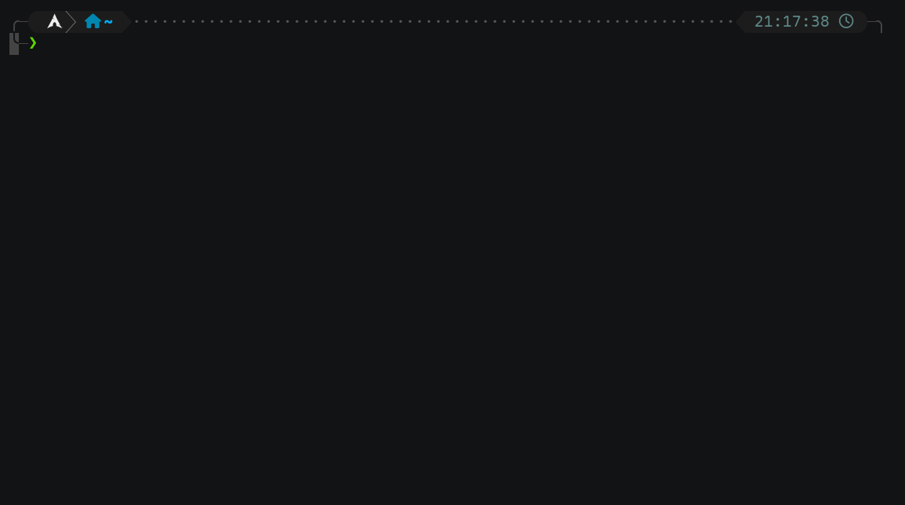
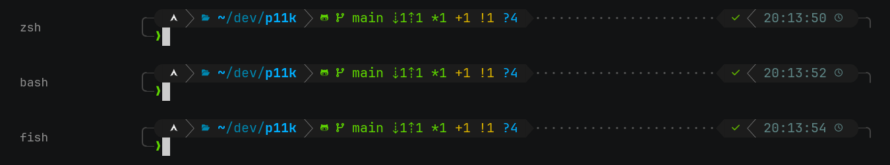
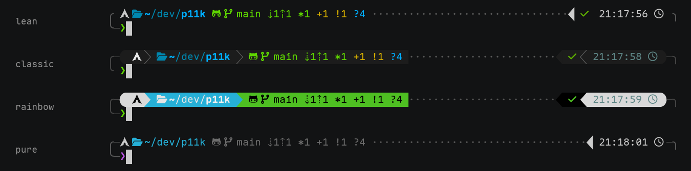

# powerlevel11k (p11k)

[English](README.md)·[](https://github.com/Qaaxaap/powerlevel11k/actions/workflows/ci.yml)·[](COPYING.LESSER)

用 Rust 重写的 powerlevel10k 提示符引擎。



p11k 仍在开发中。功能已完整，开发者日常在用，但尚未定型，配置语言仍可能变动。

powerlevel10k 在 2024 年进入纯维护模式。它不再新增功能，多数 bug 不再修复，issue 无人回应，仓库也不会移交。它今天依然好用，但需要 v1.20.0 之后功能的人没有可选方案。p11k 从这里接手，保住 p10k 的外观与速度，把整条链路换成 Rust。

它不再是传统的 shell 主题。引擎接管整个终端，作为透明代理在 pty 里启动一个未加载主题的 shell。字节原样透传，引擎只在提示符出现的瞬间绘制。同一套主题因此可以用在 zsh、bash、fish 上，其它 shell 也可以，只需简单适配。

目前支持 bash、fish、zsh、pwsh。其它 shell 的适配欢迎贡献。

## 快速试用

```bash
nix run github:Qaaxaap/powerlevel11k -- --shell zsh   # 不安装、不配置
```

其它安装方式见[安装](#安装)。

## 一套主题，所有 shell

头部由引擎绘制，不由 shell 绘制。同一份主题文件在 zsh、bash、fish 下给出相同的提示符。



## 内置主题

`--preset lean|classic|rainbow|pure` 可以不写配置就选定起点。`p11k configure` 像 p10k 的向导那样逐项询问，并写出 KDL。四者都是普通主题，任何内容都可以修改。

下图把四套配色放进同一个布局，方便对比。preset 也带布局，lean 与 pure 是单行、无边框。颜色取自 preset；preset 没有定义的段用终端默认色。



## 主要功能

- **多行头部**：p10k 风格，由 KDL v2 配置生成。
- **instant header**：终端打开即显示提示符，不等待 shell 加载配置。
- **transient prompt**：命令提交后，头部折叠为单行 `❯`。目前仅支持 zsh。
- **vi_mode / history / 宽松布局**：vi 模式指示、历史命令号与 `prompt-add-newline` 空行，随配置启用。
- **80+ 内置段**，与 p10k 的段一一对应：
  - `dir`、`vcs`、`status`、`time`、`command_execution_time`、`background_jobs`
  - 语言版本：go、rust、node、php、java、dotnet、swift
  - 云服务：aws、azure、gcloud、kube、terraform
  - 网络：ip、vpn、wifi、public_ip
  - 系统：load、ram、swap、battery、disk
  - 环境指示器：virtualenv、pyenv、rvm、nvm
- **git 状态**：仓库状态在后台线程计算，大仓库也不会阻塞提示符。
- **主题语言 KDL v2**：`layout` / `segments` / `defaults` / `separators` / `frame` / `vcs-remote-icons` / `mode` / `icon`，语法见 [docs/config-language.zh.md](docs/config-language.zh.md)。视觉不硬编码在引擎里，换配置即换主题。
- **三套图标**：`nerdfont` / `compatible` / `ascii`，按实际字体选用。locale 非 UTF-8 时自动降级为 `ascii`。顶层 `icon{}` 可按图标名逐档覆盖字符。

## 引擎原理

引擎是 pty 宿主兼透明代理。它在 pty 中启动一个未加载主题的 shell，原样转发字节，仅在提示符出现的时刻绘制。

shell 钩子宣告提示符就绪后，引擎绘制主题头部，绘制完成后交还控制。输入行仍由 shell 自己的行编辑器绘制，补全、历史与 vi 模式的几何因此保持自洽。

几何由零宽的就绪信号保证。shell 的提示符字符串在头部所需的空行之后携带 `OSC 1337;p11k;p`，引擎收到信号后把这些空行画成真实头部。输入行前缀属于 shell 的提示符字符串，行编辑器才会把用户缓冲区画在它后面。引擎不解析 pty 输出中的 ANSI 序列，也不修改用户输入。

## 安装

Nix flake：

```bash
nix profile install github:Qaaxaap/powerlevel11k
```

作为 home-manager input：

```nix
inputs.p11k.url = "github:Qaaxaap/powerlevel11k";
home.packages = [ inputs.p11k.packages.${pkgs.system}.default ];
```

Debian / Ubuntu：从 [release](https://github.com/Qaaxaap/powerlevel11k/releases) 下载 `.deb`。

```bash
sudo apt install ./p11k_<version>_amd64.deb
```

其它发行版解压 tar 包。`bin/` 与 `share/` 可重定位，词条既从系统目录查找，也从可执行文件旁查找。

```bash
tar xzf p11k-<version>-x86_64-linux.tar.gz -C ~/.local
~/.local/p11k-<version>-x86_64-linux/bin/p11k --shell zsh
```

tar 包需要系统已安装 OpenSSL 3 运行库与系统 C 库，常见发行版默认提供。每个 release 还附带 `runtime-dependencies.md`，由 `ldd` 从二进制生成，列出确切依赖。

从源码构建并安装：

```bash
cargo install --path crates/p11k-engine
```

需要 Rust 工具链。`msgfmt`（gettext）用于生成翻译。缺失时构建仍然成功，界面只是没有翻译。

以上构建均为 x86_64 Linux。

## 接入 shell

若原先使用其它 shell 主题，必须先移除。p11k 不是传统 shell 主题，两者会叠加显示。

在 shell 的 rc 文件中加入一行：

```bash
# zsh
[[ -z "$P11K_ENGINE" ]] && exec /path/to/p11k --shell zsh
# bash
[[ -z "$P11K_ENGINE" ]] && exec /path/to/p11k --shell bash
# fish
if not set -q P11K_ENGINE; exec /path/to/p11k --shell fish; end
```

PowerShell 写入 `$PROFILE`：

```powershell
if (-not $env:P11K_ENGINE) { & '/path/to/p11k' --shell pwsh; exit }
```

`--shell` 可以省略，在主题配置里写 `shell "zsh"` 即可。两者都没有时，引擎回退到 `$SHELL`，但它可能不是你期望的 shell。

引擎以 exec 覆盖启动它的 shell，并继承其环境。内层 shell 会重新加载用户配置，主题除外。`P11K_ENGINE` 用于防止递归启动。

由于这一设计，请把启动 p11k 的命令放在 rc 文件顶部，否则会产生重复加载。

## 主题配置

主题是 KDL v2 文件，语法见 [docs/config-language.zh.md](docs/config-language.zh.md)。

引擎默认读取 `$XDG_CONFIG_HOME/p11k/p11k.kdl`。该文件不存在时，引擎使用内置的 lean 主题，`p11k configure` 向导会把配置写到那里。`--config <path>` 可指定其它文件，`--preset <name>` 可选用内置主题（lean / classic / rainbow / pure）。

`p11k reload` 让正在运行的会话重新读取主题文件，无需重开 shell：

```bash
$EDITOR ~/.config/p11k/p11k.kdl
p11k reload
```

引擎重绘头部并重启 git worker，`vcs` 相关属性同样生效。文件解析失败时，该命令返回错误，当前主题保持不变。输入行的宽度在引擎启动时固定。改变宽度的 `prompt_char` 会被忽略，引擎日志会记下这一点。颜色、布局、段、分隔符与边框立即生效。

## 界面语言

界面文案支持中文与英文，其它语言的翻译欢迎贡献。按标准环境变量（`LANG`、`LC_ALL`、`LANGUAGE`）选择，默认英文：

```bash
LANG=zh_CN.UTF-8 p11k --shell zsh   # 中文界面
p11k --shell zsh                    # 英文（默认）
```

`P11K_LOCALEDIR` 可指定词条目录。通过安装包或 flake 安装时无需设置。

## compat/p10k：替换 gitstatusd

`compat/p10k` 分支把原版 p10k 主题 vendor 进来，只替换内核。`p11k-d` 按 gitstatusd 线上协议逐字节应答，可以直接作为原版 `gitstatus.plugin.zsh` 的后端。

```bash
export GITSTATUS_DAEMON=/path/to/p11k-d
```

配置、外观、status 与 vcs 与 p10k 完全一致。

该分支不是主要开发方向，主线是 `main` 上的引擎，但仍会保证维护。

## 项目状态

已完成：

- gitstatusd 兼容内核（v1.5.5 协议）与性能核心：index 解析、`fstatat` 扫描、并行分片、untracked cache
- 占位协议：多行头部几何自洽，覆盖 zsh / bash / fish / pwsh
- instant / transient prompt、vi_mode、history、宽松布局
- 80+ 段、KDL 主题语言、三档图标与 `icon{}` 覆盖
- `p11k configure` 向导、gettext 词条（zh_CN）、CI
- `p11k reload`；p10k 功能已对齐至扩展状态（`OK_PIPE` / `ERROR_PIPE` / `ERROR_SIGNAL`）与 `VCS_DISABLED_WORKDIR_PATTERN`
- p10k 开关：`ICON_PADDING`、`ICON_BEFORE_CONTENT`、`TRANSIENT_PROMPT` 在各档取值下与 p10k 一致，包括 `moderate`、显式逐段覆盖与 `same-dir`
- 发布产物：Nix flake、`.deb` 与 tar 包

未做：

- `LEGACY_ICON_SPACING` 不打算实现，它复刻的是 powerlevel9k 的布局 bug
- `DIR_MAX_LENGTH` 与 `DIR_MIN_COMMAND_COLUMNS(_PCT)` 无法实现，它们需要读取 zle 的 buffer，而引擎看不到
- macOS 支持
- daemon 与引擎的长期维护和加固

## 参与开发

构建与测试环境、提交规范、翻译流程与发布流程见 [CONTRIBUTING.zh.md](CONTRIBUTING.zh.md)。

## 许可证

LGPL-3.0-or-later。[COPYING.LESSER](COPYING.LESSER) 是许可证本身，[COPYING](COPYING) 是它所扩展的 GPL-3.0。

`compat/p10k` 分支 vendor 的 powerlevel10k 主题为 MIT，版权归 Roman Perepelitsa 及贡献者，原版权声明保留在 `compat/p10k/vendor/powerlevel10k/LICENSE`。
